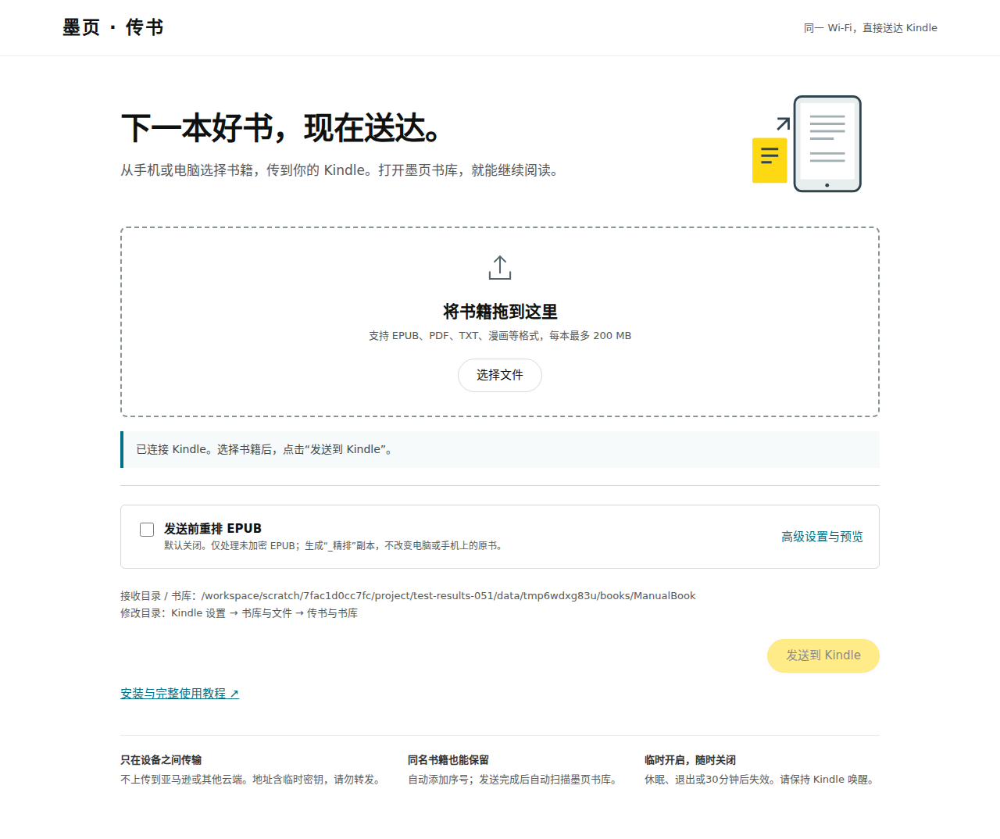
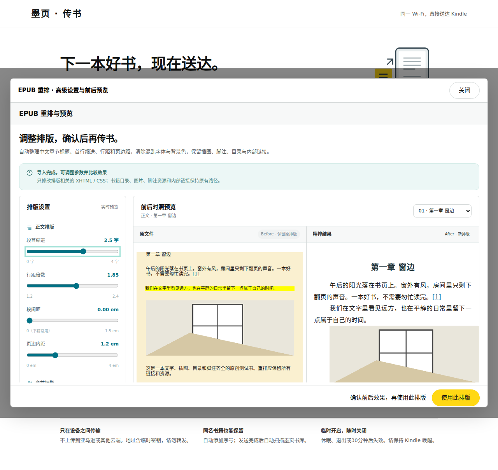
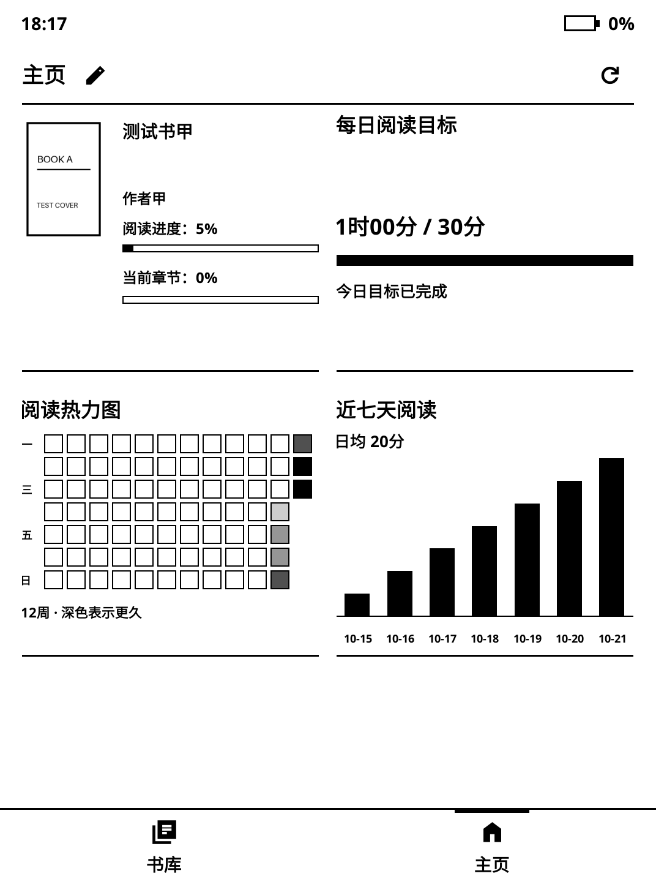

# ClassicUI · 墨页

为 KOReader 提供统一的黑白阅读前端：书库、主页、阅读菜单和设置。首测设备为 Kindle Voyage，当前支持 **KOReader v2026.07.1 / v2026.07.2 stable**，固定源码 `9192014d8bd82a91dc1012473be0f238dedfdb54`。不修改 KOReader 核心文件。

**当前版本：0.5.0-test.10，离线测试版。在线更新和中转已移除，此前所有 Release 已下架。请完全退出旧版 KOReader 后手动安装本版，不再使用旧版在线更新。**

## 下载与安装

从 [测试版发布页](https://github.com/ManXiangTAS/classicui.koplugin/releases/tag/v0.5.0-test.10) 下载 `ClassicUI_0.5.0-test.10_install.zip`。

1. 完全退出 KOReader，升级前备份原插件和 `koreader/settings`。
2. 将压缩包中的 `einkfrontend.koplugin` 文件夹复制到 `koreader/plugins/`，升级时覆盖同名插件。
3. 保留文件夹名称 **einkfrontend.koplugin**。仓库名 ClassicUI 不等于安装目录名，也不要求重命名已有配置。
4. 重启 KOReader，在插件管理中启用“墨页前端”。

恢复原生界面：设置 → 维护与恢复 → 前端开关与恢复，可临时进入原生菜单或停用插件。如果界面无法打开，完全退出 KOReader 后移走 `plugins/einkfrontend.koplugin`，保留书籍和设置，再启动。

## 本版变化

- 移除插件的手动/自动在线更新、所有更新源及维护菜单和搜索入口。启动与唤醒不再启动更新任务，不提供 GitHub 或中转回退。
- 启动时停用旧更新设置并清理插件专用暂存目录；不执行旧待安装包，也不读取旧恢复记录来替换代码。覆盖安装携带旧模块的禁用占位文件，避免残留模块恢复更新功能。
- 本版仅支持手动安装。先完全退出 KOReader，通过 USB 将安装包中的 `einkfrontend.koplugin` 覆盖到 `koreader/plugins/`，保留目录名称与书籍/配置。详见[离线版说明](docs/0.5.0-test.10_移除在线更新.md)。
- 书库、主页、输入法、Kindle 图片屏保、阅读、局域网传书与主页编辑保留。

以下为0.5.0-test.8已加入的功能：

- 「设置 → 设备与系统 → 屏保 → 壁纸」增加“使用 Kindle 原生屏保”，移除原来的独立入口。只调用 KOReader 随机图片模式并自动检测原生图片目录；保留填充、旋转、拉伸、循环顺序和休眠文字。
- 与其他壁纸单选互斥，切回自定义随机图片时恢复之前的目录；兼容旧版屏保备份。找不到图片时保留当前设置。详见[屏保壁纸整合说明](docs/0.5.0-test.8_屏保壁纸整合.md)。
- 设置搜索优先扫描现有菜单项，再展开较大的动态列表，避免深层设置被搜索额度遗漏。

此前在线更新相关版本均已下架，功能不再提供。

以下为0.5.0-test.6已加入的功能：

- 键盘上方常驻“中 / EN”，一键切换，深色标出当前语言；英文状态也保留切回中文的入口。切换后记住选择，英文使用原生英文标点与大小写键位。切到英文时保留未选字拼音，已输入文字不变。详见[本版说明](docs/0.5.0-test.6_中英一键切换.md)。

以下为0.5.0-test.5已加入的功能：

- 新增离线拼音候选栏：点选、翻页、空格选字与回车保留字母；数字、密码与显式路径框直接输入。检测到启用的外部拼音插件时让位。
- 当时新增独立的 Kindle 原生屏保页；自 test.8 起合并到「屏保 → 壁纸」，旧设置保留。图片仅从设备读取。
- 设置 → 触控与按键 → 中文输入法，可切换中文键盘、开关候选栏和试输入。使用现有字词库，暂不支持整句联想与双拼。详见[本版说明](docs/0.5.0-test.5_输入法与原生屏保.md)。

以下为0.5.0-test.4已加入的修复：

- 菜单显示和打开共用明确的页面条件，切换时清理无效菜单与旧点击区域；修复主题更多的点击重叠、返回层级和过期输入/确认回调。收藏管理恢复局部搜索放大镜。手机编辑修复防火墙规则位置及过期请求边界。详见[复查与修复说明](docs/0.5.0-test.4_菜单与边界复查.md)。

以下为0.5.0-test.3已加入的功能：

- 三个点仅出现在设置首页，点击后在按钮下方展开两行小菜单，仅含“搜索”和“重启 KOReader”。设置子页面去掉三个点；点外侧关闭且不会触发底层设置，旋转和切换页面时自动收起。详见[版本说明](docs/0.5.0-test.3_设置更多菜单.md)。

以下为0.5.0-test.2已加入的功能：

- 标准提示、确认、输入、菜单、词典、数值/日期选择、图片预览及进度条统一直角样式；使用标准控件的插件自动承接。保留原生行为和有意设计的圆形控件，停用后撤销适配。本轮659次检查通过，详见[版本说明](docs/0.5.0-test.2_基础控件统一.md)与[接管清单](docs/native-controls/接管清单.md)。

以下为0.5.0-test.1已加入的功能：

- 设置页右上角三个点提供搜索和重启 KOReader。
- 首次向导可设置传书与书库共用目录，默认 `/mnt/us/documents/ManualBook`；在设置中可更改。
- 同一 Wi-Fi 扫码打开临时网页，拖放或多选传书；同名书籍保留，完成后自动更新书库。
- EPUB 重排手动勾选，支持高级参数和前后预览。采用统一的白色页面、蓝色辅助操作和黄色主按钮。
- [传书与重排说明](docs/0.5.0_网页传书与重排.md) · [安装与完整使用教程](docs/墨页安装与使用教程.html)。

- 修复翻页键唤醒时系统暂时占用后不再应用覆盖、恢复后旧错误残留的问题。最多短时重试4秒，不解除系统锁；错误提示去掉代码路径。说明移至标题旁的信息图标。

- 主页固定在标题栏和底部导航之间，上下滑动、拖动或翻页键不再滚动内容。所有部件按可用高度调整，半行配对等高；保持可读的最小尺寸。一屏放不下时编辑器提示调整，不会自动删除旧配置。设备和手机预览使用同一范围。见 [主页固定一屏](docs/主页固定一屏.md)。

- Voyage 设置 → 触控与按键 → 翻页键（原 PagePress）：翻页开关、按压力度、震动反馈与强度、反转翻页方向。每项支持沿用 Kindle 设置；退出和休眠时尝试恢复进入前的硬件值。见 [PagePress 说明与验证边界](docs/PagePress.md)。

- 主题按参考样式使用双列图标与文字，仅内置“默认”，并保留用户保存的主题；主题图标改用同套 Material Sharp 排版图标。底部有保存当前设置和管理主题入口。
- 隐藏“设为默认 / 恢复继承”操作行；字体、排版、主题的叉号关闭整个设置菜单。
- 阅读下拉移除“书库 / 主页”和“同步”快捷项；正常阅读返回及设置中的同步功能保留。
- 收藏页只列收藏夹；从收藏管理创建收藏，可单独设为在书库隐藏，原生收藏和待读部件仍能使用。
- 时间与日期使用统一的居中单行设置样式，移除提示性说明和时区范围行。
- 主页铅笔打开即时预览编辑器，可调整13种部件的显隐、整行/半行、顺序和内容，保存前保留草稿。
- 手机与 Kindle 连接同一 Wi-Fi 后，可在编辑器中点“手机编辑”扫码，用浏览器调整主页、查看实际预览并保存回 Kindle。会话15分钟到期，关闭编辑器、停用插件或休眠时结束。
- 搜索按位置区分：全部设置、主页部件、时区、当前收藏管理页、书库、当前分类的书籍、当前书的目录/书签/标注。
- 维护与恢复细分为前端恢复、原生界面设置、诊断工具及退出操作。原生文件列表显示、排序和封面模式等放入原生界面设置。

以上为实际 KOReader 桌面离屏截图，使用原创测试书籍与隔离数据，不是真机照片。

## 使用范围

主页包含最近在读、当前书统计、书库概览、最近阅读书架、待读书架、名言、时钟、热力图、统计表、七天柱图、阅读天数、时段分布和每日目标。升级保留已有部件、顺序、名言和宽度，新部件默认隐藏。

网络校时调用 KOReader 原生 timesync，时区支持419个 IANA 地区及夏令时。时区作用于 KOReader 进程，不修改设备全局时区；NTP、RTC、Kindle 防火墙、PagePress、休眠和残影仍需实机检查。

手机编辑使用临时的局域网 HTTP 服务，只在手动开启期间运行。二维码含会话密钥，不要转发；请在可信 Wi-Fi 使用。编辑服务只接受主页布局，不能访问文件或执行命令，不依赖公网网站或云端账号。

## 验证与开发

见 [本轮复查说明](docs/0.5.0-test.4_菜单与边界复查.md)、[实测指南](Voyage_0.4.0_实测指南.md) 和 `test-results-054/combined-summary.json`。本轮使用官方 KOReader Linux AppImage、真实 Lua 模块和 Chromium 重新验证菜单上下文、旧回调、搜索及网络边界；未重跑的旧报告保留为历史证据。所有书籍和配置均在隔离目录中。测试报告不代表真机通过。

`python tests/build_public_release.py dist` 可重建公开安装包与源码包，并验证插件源文件哈希、时区、图标和许可。集成运行器用法：`python tests/run_regression046.py /absolute/path/to/koreader`；其他回归运行器位于 `tests/`。手机编辑测试额外需要 Playwright/Chromium，环境变量 `EINK_CHROMIUM` 指定浏览器。

仓库发布当前经过清理的源码快照；旧开发历史、完整交接资料及旧截图另随完整移交包保存，不混入公开发布的设备配置或临时日志。

## 许可

原创代码使用 **AGPL-3.0-or-later**，见 [COPYING](COPYING)。图标为 Material Symbols Sharp，保留 Apache-2.0 许可和来源；IANA 2026e 时区数据保留公共领域声明、来源及编译记录。
