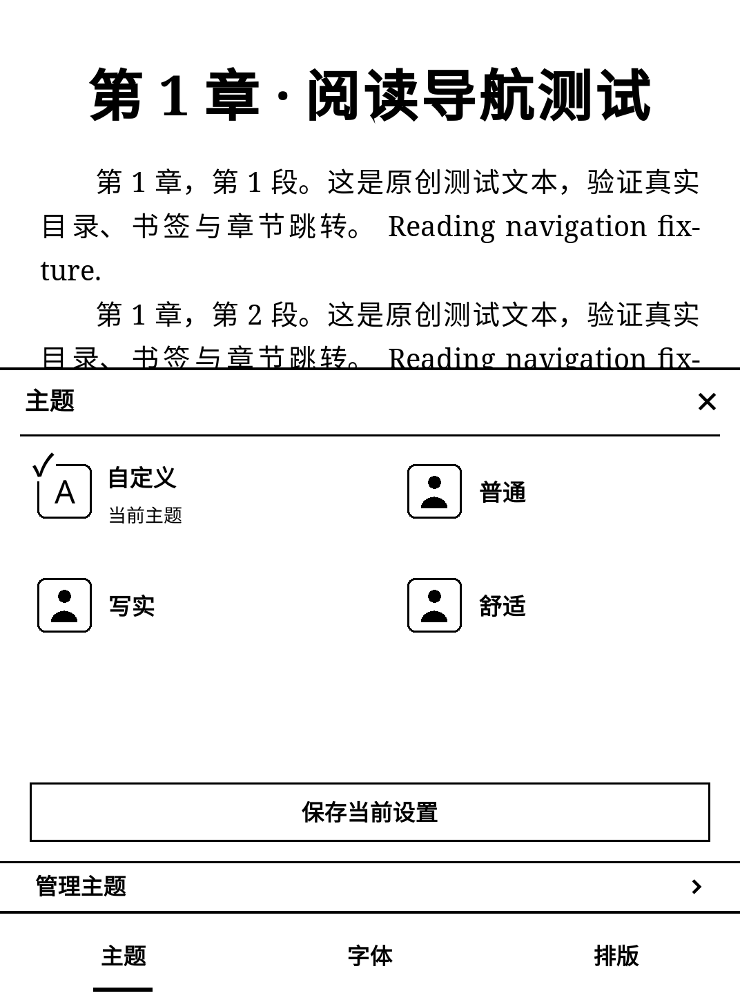
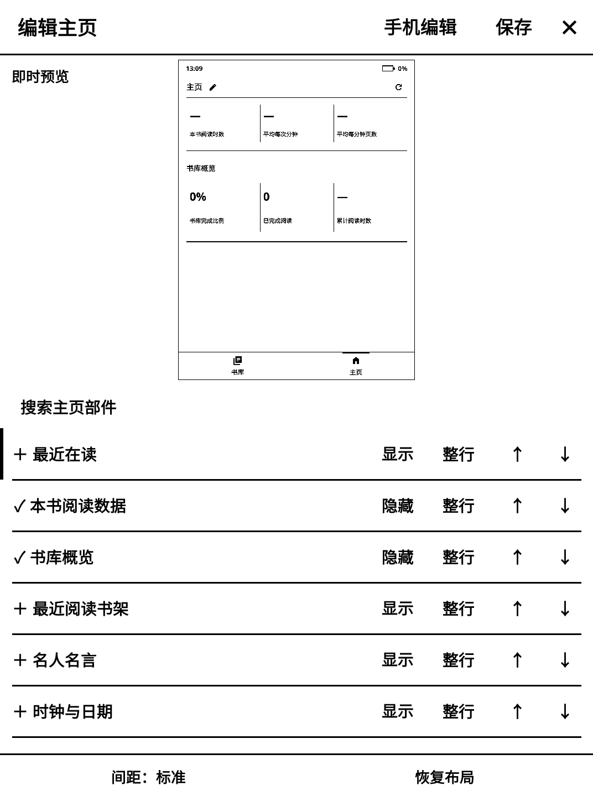

# ClassicUI · 墨页

为 KOReader 提供统一的黑白阅读前端：书库、主页、阅读菜单和设置。首测设备为 Kindle Voyage，当前支持 **KOReader v2026.07.1 / v2026.07.2 stable**，固定源码 `9192014d8bd82a91dc1012473be0f238dedfdb54`。不修改 KOReader 核心文件。

**当前版本：0.4.0-test.1，公开测试版。桌面集成与浏览器验证通过，修改后尚未进行 Voyage 真机验收。**

## 下载与安装

从 [测试版发布页](https://github.com/ManXiangTAS/classicui.koplugin/releases/tag/v0.4.0-test.1) 下载 `ClassicUI_0.4.0-test.1_install.zip`。

1. 完全退出 KOReader，升级前备份原插件和 `koreader/settings`。
2. 将压缩包中的 `einkfrontend.koplugin` 文件夹复制到 `koreader/plugins/`，升级时覆盖同名插件。
3. 保留文件夹名称 **einkfrontend.koplugin**。仓库名 ClassicUI 不等于安装目录名，也不要求重命名已有配置。
4. 重启 KOReader，在插件管理中启用“墨页前端”。

恢复原生界面：设置 → 维护与恢复 → 前端开关与恢复，可临时进入原生菜单或停用插件。如果界面无法打开，完全退出 KOReader 后移走 `plugins/einkfrontend.koplugin`，保留书籍和设置，再启动。

## 本版变化

- 主题按参考样式使用双列图标与文字，提供普通、写实、舒适、自定义及已保存主题。底部有保存当前设置和管理主题入口。
- 隐藏“设为默认 / 恢复继承”操作行；字体、排版、主题的叉号关闭整个设置菜单。
- 阅读下拉移除“书库 / 主页”和“同步”快捷项；正常阅读返回及设置中的同步功能保留。
- 收藏页只列收藏夹；从收藏管理创建收藏，可单独设为在书库隐藏，原生收藏和待读部件仍能使用。
- 时间与日期使用统一的居中单行设置样式，移除提示性说明和时区范围行。
- 主页铅笔打开即时预览编辑器，可调整13种部件的显隐、整行/半行、顺序和内容，保存前保留草稿。
- 手机与 Kindle 连接同一 Wi-Fi 后，可在编辑器中点“手机编辑”扫码，用浏览器调整主页、查看实际预览并保存回 Kindle。会话15分钟到期，关闭编辑器、停用插件或休眠时结束。
- 搜索按位置区分：全部设置、主页部件、时区、当前收藏管理页、书库、当前分类的书籍、当前书的目录/书签/标注。
- 维护与恢复细分为前端恢复、原生界面设置、诊断工具及退出操作。原生文件列表显示、排序和封面模式等放入原生界面设置。

以上为实际 KOReader 桌面离屏截图，使用原创测试书籍与隔离数据，不是真机照片。

## 使用范围

主页包含最近在读、当前书统计、书库概览、最近阅读书架、待读书架、名言、时钟、热力图、统计表、七天柱图、阅读天数、时段分布和每日目标。升级保留已有部件、顺序、名言和宽度，新部件默认隐藏。

网络校时调用 KOReader 原生 timesync，时区支持419个 IANA 地区及夏令时。时区作用于 KOReader 进程，不修改设备全局时区；NTP、RTC、Kindle 防火墙、PagePress、休眠和残影仍需实机检查。

手机编辑使用临时的局域网 HTTP 服务，只在手动开启期间运行。二维码含会话密钥，不要转发；请在可信 Wi-Fi 使用。编辑服务只接受主页布局，不能访问文件或执行命令，不依赖公网网站或云端账号。

## 验证与开发

见 [版本说明](docs/0.4.0_主题与主页编辑.md)、[实测指南](Voyage_0.4.0_实测指南.md) 和 `test-results-046/combined-summary.json`。测试使用官方 KOReader Linux AppImage、真实 Lua 模块、crengine/MuPDF 及 Chromium，所有书籍和配置均在隔离目录中。测试报告不代表真机通过。

`python tests/build_public_release.py dist` 可重建公开安装包与源码包，并验证插件源文件哈希、时区、图标和许可。集成运行器用法：`python tests/run_regression046.py /absolute/path/to/koreader`；其他回归运行器位于 `tests/`。手机编辑测试额外需要 Playwright/Chromium，环境变量 `EINK_CHROMIUM` 指定浏览器。

仓库发布当前经过清理的源码快照；旧开发历史、完整交接资料及旧截图另随完整移交包保存，不混入公开发布的设备配置或临时日志。

## 许可

原创代码使用 **AGPL-3.0-or-later**，见 [COPYING](COPYING)。图标为 Material Symbols Sharp，保留 Apache-2.0 许可和来源；IANA 2026e 时区数据保留公共领域声明、来源及编译记录。主题示例小图由项目代码绘制。
