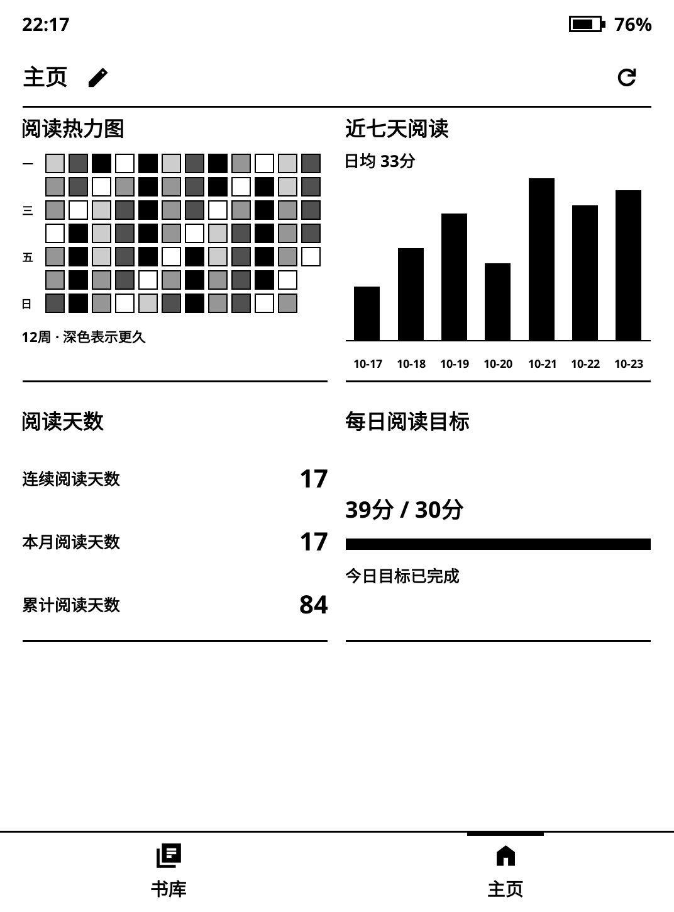
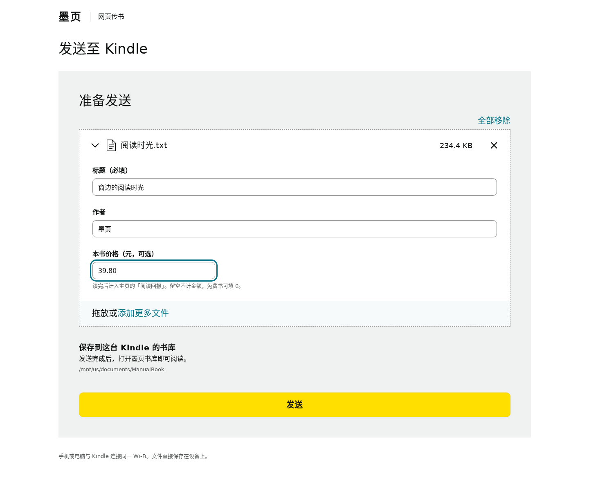

# 墨页 · ClassicUI

**把设备，读成自己的。**

墨页是一套为电子墨水屏设计的 KOReader 阅读前端。我们把主页、书库、阅读工具和设置放进同一套黑白、方正的界面，让找书、阅读与日常操作保持一致。

[下载 0.6.0](https://github.com/ManXiangTAS/classicui.koplugin/releases/latest) · [安装与使用](docs/guide.md) · [版本变化](CHANGELOG.md) · [常见问题](docs/troubleshooting.md)

## 这台 Kindle，读回本了吗？

「阅读回报」把你读完的书，变成一个不断前进的圆环。填入购机投入和本书价格，标记一本“已完成”，进度就向前一步。从“故事刚开始”到“已经回本”，再到“越读越值”，给每次读完留下一点小小的仪式感。

书价是可选记录：免费书可以填 0，未填价格不计金额；重复阅读不重复累计，相同上传文件只计一次。超过 100% 后仍显示实际比例。这里记录的是你赋予阅读的价值，不代表实际节省或投资收益。

## 从找书到阅读，都用同一套界面

- **自己的主页**：14 种部件，整行或半行排列。最近在读、名言、书架、时钟、热力图、统计表、七天柱图、阅读天数、时段分布、每日目标和阅读回报。固定一屏，部件自动适应高度。
- **即时编辑**：主页标题旁点铅笔，直接看布局预览；也能扫码，在手机或电脑浏览器中编辑并保存。
- **独立书库**：封面墙与列表，按书籍、作者、系列和收藏浏览；支持筛选、排序、搜索、修改系列、编辑书名与作者。收藏夹可单独隐藏。
- **舒服的阅读**：字体、字号、行距、页边距、对比度、字重与命名主题；目录、书签、标注和本书统计都有清晰入口。
- **顺手的操作**：按钮点击反色反馈；滚动条有独立留白、更宽的触摸范围，支持点按、拖动和长按拖动。
- **中英输入**：常驻「中 / EN」切换与离线拼音候选。密码、数字等专用输入框保持原输入方式。
- **设备功能**：分层设置、时区与网络校时、可用设备上的前光与旋转；Kindle 原生屏保图片选项，Voyage 翻页键设置。

 

## 拖进来，改好名字，发送

在 Kindle 开启网页传书，手机或电脑连接同一 Wi-Fi 后扫码。拖入书籍，编辑标题、作者和可选的本书价格，再点发送。文件直接保存在设备上，随后更新墨页书库。

默认目录为 `/mnt/us/documents/ManualBook`，可在设置中更改。单文件上限 200 MB，每次最多选择 20 个。重复文件名自动加序号，不覆盖已有书。书名和作者保存为 KOReader 共用的本机元数据，原书内容保持不变。

## 安装

适用 **KOReader v2026.07.1 / v2026.07.2**。从 Release 下载 `ClassicUI_0.6.0_install.zip`，不要把 GitHub 自动生成的 Source code 压缩包直接当作插件安装。

1. 完全退出 KOReader，升级前备份原插件与设置。
2. 解压，将 **`einkfrontend.koplugin`** 复制到 `koreader/plugins/`，升级时覆盖同名目录。
3. 保留该目录名称，重启 KOReader，在插件管理中启用「墨页 · ClassicUI」。

墨页与 SimpleUI 等会接管相同入口的界面插件，建议择一启用。部分第三方插件仍使用自己的原生窗口。设备功能按硬件能力显示；本版经过桌面运行与浏览器测试，电子墨水屏触感、残影及设备专用功能仍需对应实机确认。

恢复原生界面：**设置 → 维护与恢复 → 前端开关与恢复**。更多操作见[使用指南](docs/guide.md)。

## 宣传片

[观看或下载《把设备，读成自己的》](https://github.com/ManXiangTAS/classicui.koplugin/releases/download/v0.6.0/ClassicUI_0.6.0_film.mp4)：黑白动效、原创配乐、2 分 28 秒。

## 我们选择的方向

SimpleUI 提供丰富的主页与导航定制。墨页更着重于从主页到独立书库、阅读菜单和分层设置的整体一致性，同时保留 KOReader 的阅读引擎与原生兼容入口。两者是不同取向的界面方案。

## 开源与反馈

代码采用 **AGPL-3.0-or-later**，第三方素材授权与来源见 [NOTICE](NOTICE.md)。本项目与 Amazon、Kindle、KOReader 或 SimpleUI 没有隶属关系。

发现问题请提交 [Issue](https://github.com/ManXiangTAS/classicui.koplugin/issues)，附设备型号、KOReader 版本、操作步骤和截图；请先遮挡个人信息、局域网地址及临时二维码。
