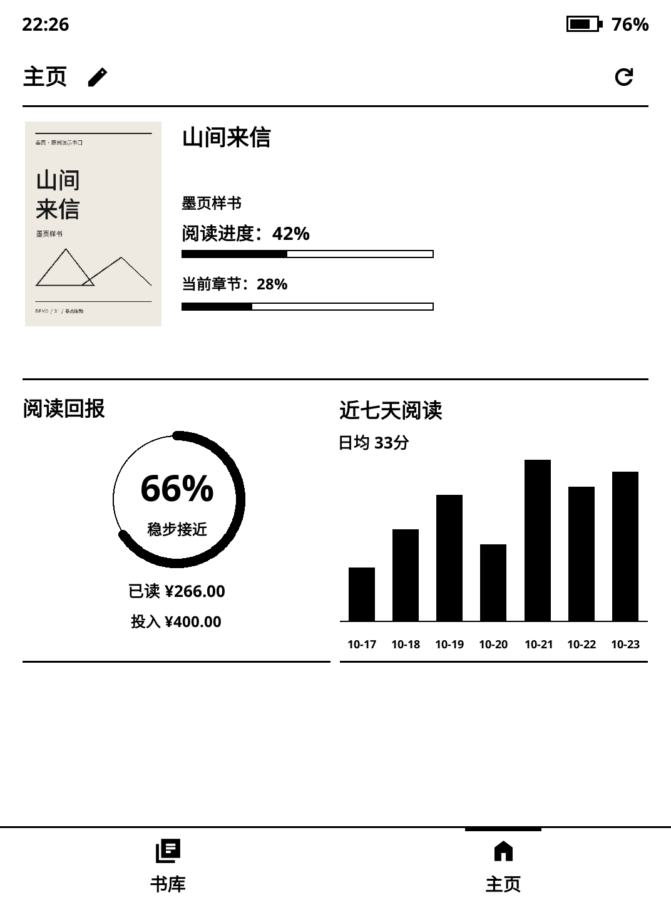
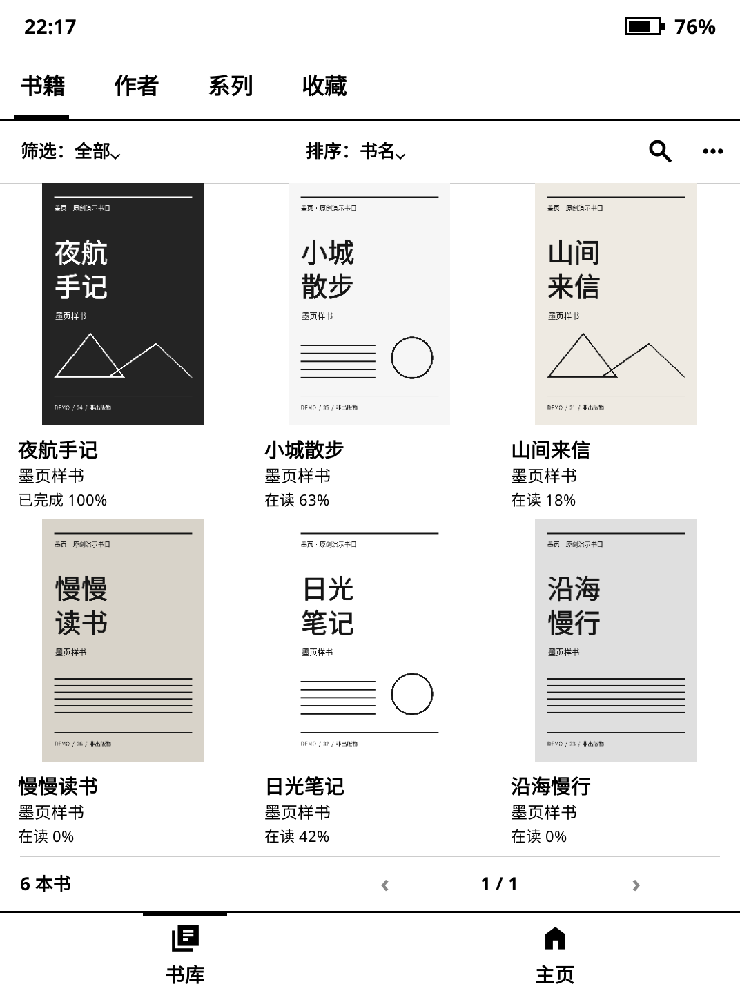

# 墨页 · ClassicUI

**为电子墨水屏设计的 KOReader 阅读前端。**

墨页把主页、书库、阅读工具和设置整合到一套方正、扁平的黑白界面里。保留 KOReader 的阅读引擎，让找书、阅读与日常操作保持一致。

[下载安装](https://github.com/ManXiangTAS/classicui.koplugin/releases/latest) · [使用指南](docs/guide.md) · [更新日志](CHANGELOG.md) · [常见问题](docs/troubleshooting.md)

 

## 核心功能

- **自定义主页**：部件与布局按需组合，固定一屏；支持在设备上或通过浏览器编辑。
- **独立书库**：按书籍、作者、系列和收藏浏览，支持筛选、排序、搜索与资料编辑。
- **阅读工具**：排版、字体、命名主题、目录、书签与标注，使用统一的操作界面。
- **阅读记录**：热力图、统计表、每日目标，以及按已读书籍价值计算进度的「阅读回报」。
- **局域网传书**：手机或电脑直接发送书籍到设备，可编辑书名、作者和可选价格。
- **日常设置**：分层菜单、中英输入切换，以及按设备能力提供的前光、时区、屏保与翻页键设置。

## 安装与兼容

面向 KOReader 已支持的全系列 Kindle，前光、光感、暖光与按键功能按硬件能力提供；各型号的适配进度见 [Kindle 支持范围](docs/kindle-support.md)。

目前适配 **KOReader v2026.07.1 / v2026.07.2**。从 [Releases](https://github.com/ManXiangTAS/classicui.koplugin/releases) 下载安装包，退出 KOReader 后，将 **`einkfrontend.koplugin`** 放入 `koreader/plugins/`，保留目录名称，再重启并启用插件。升级前请备份原插件与设置。

与 SimpleUI 等接管相同入口的界面插件建议择一启用。部分第三方插件仍使用自己的窗口；设备专用功能与电子墨水屏表现需在对应实机上确认。完整步骤及恢复原生界面的方法见[使用指南](docs/guide.md)。

## 反馈与许可

欢迎提交 [Issue](https://github.com/ManXiangTAS/classicui.koplugin/issues)，说明设备型号、KOReader 版本及复现步骤。

代码采用 **AGPL-3.0-or-later**。第三方授权见 [NOTICE](NOTICE.md)。本项目与 Amazon、Kindle、KOReader 或 SimpleUI 没有隶属关系。
