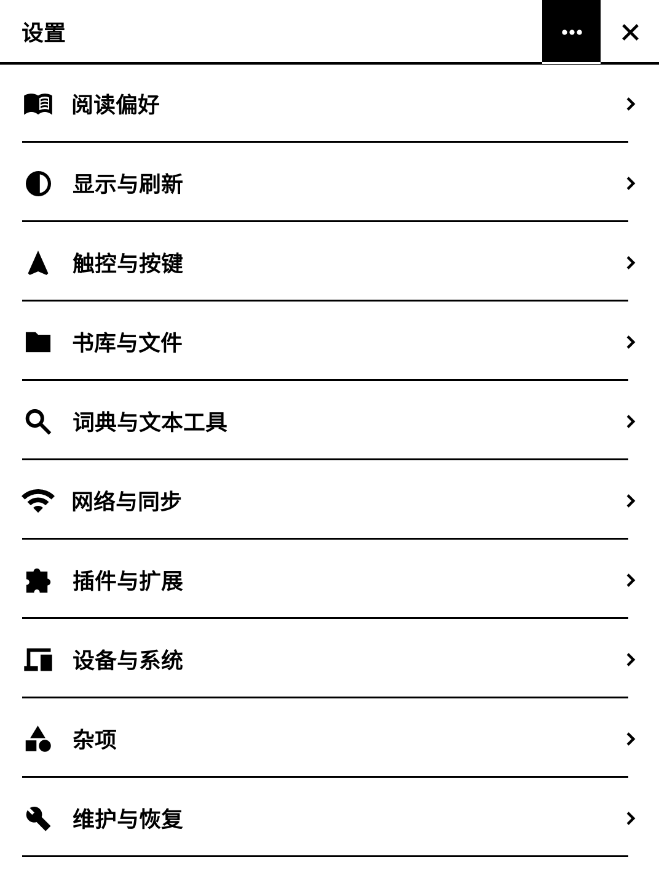
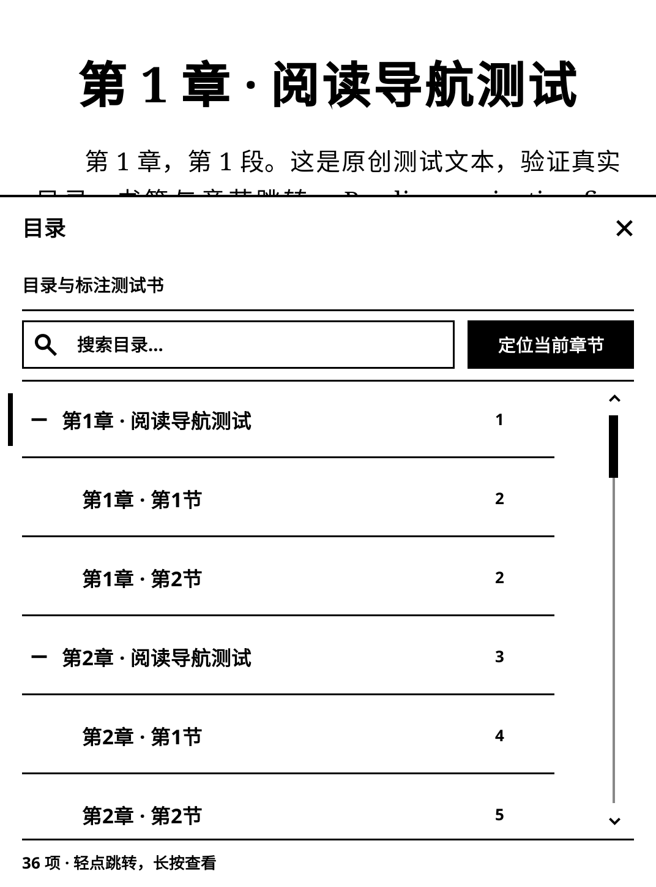
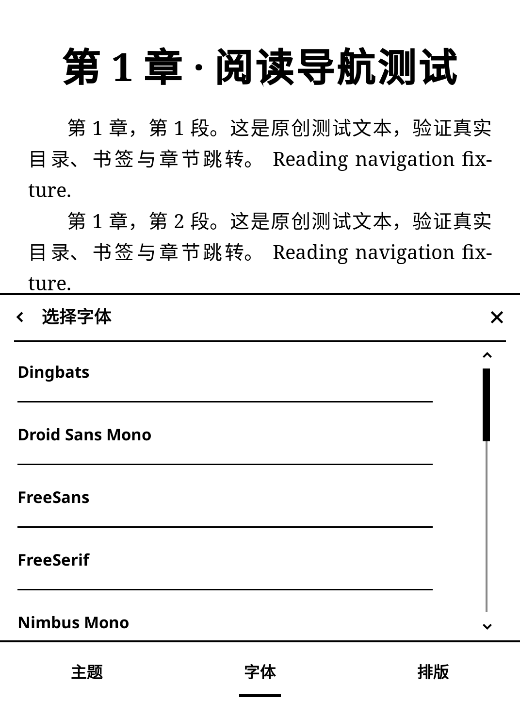

# 墨页 0.5.0-test.11：点击反馈与滚动条

自绘按钮现在点击时局部反色，先显示反馈，再执行操作。覆盖设置、书库、主页、阅读菜单、弹出菜单、主页编辑及中英输入栏。禁用项目不响应；滑条通过滑块位置反馈，避免拖动时反复闪烁。沿用 KOReader 的 `flash_ui` 开关，若主动关闭界面点击反馈，本插件也不闪烁。

滚动条移入独立操作区：触摸宽度 44、滑块宽度 8、屏幕右边距 16、内容间距至少 12、滑块最小高度 36（均为随 DPI 缩放的逻辑像素）。支持上下按钮、点轨道、直接拖动和长按拖动；拖动时抓取位置保持稳定，手指离开轨道也能继续拖到两端。目录页码、标注详情入口与字体选项不会进入滚动条触摸区域。滚动条只在内容超出时出现。

字体列表原来的滚动条只有绘制、没有拖动处理，本版补齐。目录、书签/标注、详情、字体/选项、长主题列表、设置、阅读统计和主页编辑共用同一滚动条。主页本身仍固定一屏。

切换页面或栏目后清理旧滚动条与手势状态；内容滑动跨入轨道不会突然跳位置。按钮反馈没有延迟回调，关闭页面后不会再执行旧按钮动作。设置三个点仍只在设置首页，仍为搜索与重启两行小菜单。

## 预览

## 验证与安装

官方 KOReader v2026.07.1 运行时，与 v2026.07.2 使用相同源码。600×800、1072×1448、1448×1072 三种布局完成 306 次检查、102 个独立案例、18 次运行；包括按键反色像素、恢复时序、手势事件、长按拖动、边界、误触隔离、已关闭控件、设置小菜单、原生控件、主页编辑、中英输入和离线启动清理。58 个 Lua 文件语法检查通过。没有 Kindle 实机，显示速度、残影与手指操作感仍待验收。

仍为离线版，不含插件在线更新或中转连接。此前在线版本继续下架。完全退出 KOReader，再将安装包中的 `einkfrontend.koplugin` 覆盖到 `koreader/plugins/`，保留此目录名称、书籍和配置。
