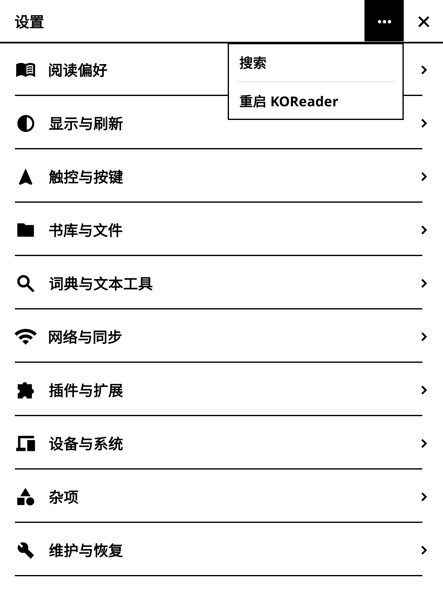

# 0.5.0-test.3：设置首页的更多菜单

- 只有设置首页右上角显示三个点。设置分类、详情、搜索结果、时间与日期等子页面保留返回、关闭及必要的帮助按钮，不再显示三个点。
- 点击后在按钮下方弹出紧凑的直角小菜单，仅含“搜索”和“重启 KOReader”两行。设置页面留在原处，展开时三个点按钮使用深色背景。
- “搜索”查找全部设置。点击后先收起小菜单，再打开搜索输入框。
- “重启 KOReader”先收起小菜单，再确认；确认后保存设置并重启，取消则留在设置首页。
- 点击外侧或再次点击三个点收起菜单，该次点击不会触发下方的设置项；返回、切换页面、休眠或旋转屏幕也会清理菜单。

截图为真实 KOReader 桌面离屏渲染，不是真机照片。

本轮在小屏、Voyage尺寸和横屏三种布局验证：新增9类小菜单检查共27次，传书与搜索/重启回归60次，设置交互回归81次，合计168次通过；另检查15张设置截图的441处像素对齐。46个插件 Lua 文件通过语法检查。没有实际重启宿主或修改 Kindle 硬件，真机验收待做。

安装方式不变：完全退出 KOReader，用安装包中的 `einkfrontend.koplugin` 覆盖 `koreader/plugins/` 下的同名文件夹，保留原设置后启动。
