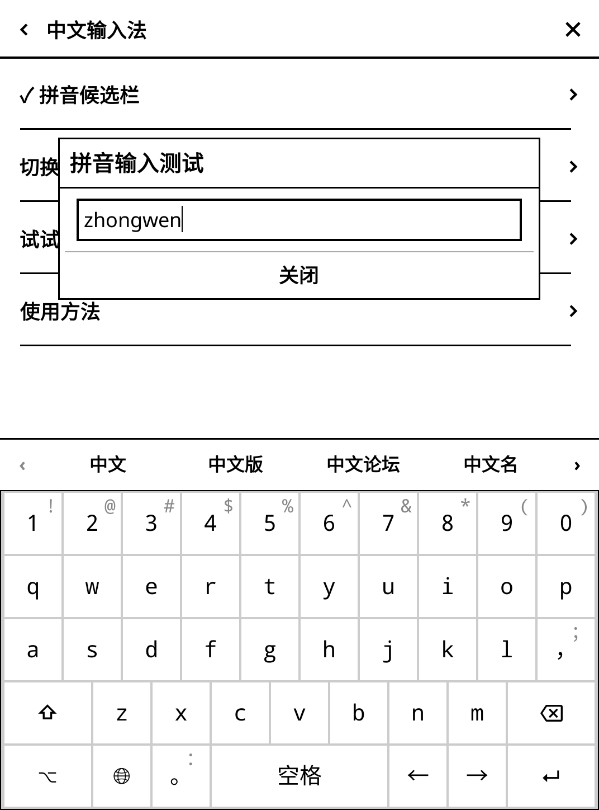

# 墨页 0.5.0-test.5：输入法与 Kindle 自带屏保

本版为测试版，固定支持 KOReader v2026.07.1 / v2026.07.2。桌面使用真实 KOReader 控件与引擎检查；Kindle 真机的按键延迟、休眠与唤醒尚未实测。

## 中文输入

入口：设置 → 触控与按键 → 中文输入法。开启“拼音候选栏”，再点“切换到中文拼音键盘”。升级不擅自改动已有键盘语言；候选栏默认在简体中文布局下生效。

- 输入全拼，在输入框保留拼音预编辑，键盘上方显示四个可点选候选。
- 点候选提交该词；左右箭头翻页；空格选择首项；回车先保留字母，再次回车沿用原输入框行为。
- 退格逐字删除拼音；移动光标、隐藏键盘或确认输入前，提交当前首选词。
- 地球键切换中英文。数字、密码与墨页的目录输入框直接输入。
- 每个输入框独立保存本次预编辑状态，关闭后释放。切换布局、页面和停用插件时撤销适配。
- 检测到启用的名称含 `pinyin` 的插件或 `moon` 插件时，墨页候选栏自动让位，避免双重接管。未涵盖未知输入法插件，遇到冲突可关闭墨页候选栏。

这是轻量字词输入增强，复用宿主自带的 Rime 派生拼音字词表，不加入联网输入、个人学习、整句解码或双拼，也不捆绑大型词库。候选列表有上限，部分生僻词需要分字输入或使用外部输入法插件。

## Kindle 自带屏保

入口：设置 → 设备与系统 → Kindle 原生屏保。只读取设备上的图片，图片仍由 KOReader 的休眠界面显示。

自动尝试 `/usr/share/blanket/screensaver` 和复数目录 `/usr/share/blanket/screensavers`；以设备上实际存在且包含图片的目录为准。可手动输入其他绝对目录。目录不存在、无法读取或没有图片时，会显示原因并保留当前设置。

点击“使用 Kindle 自带图片”后随机显示该目录图片，关闭休眠提示文字、保持比例并使用白色留边。“预览图片”显示目录中首张图片。只扫描 PNG / JPG / JPEG，最多 256 张，每张文件不超过 25 MiB。

启用前备份涉及的 KOReader 屏保选项。“恢复之前的屏保”只恢复仍由该功能保持的值；用户之后在原生设置中更改的值予以保留。设置写入失败会回滚。入口保留“其他屏保设置”。

不修改 Kindle 系统分区，不覆盖或复制系统图片，不操作 Kindle 框架或电源服务，不捆绑亚马逊屏保资源。图片目录可以在关闭框架运行 KOReader 时读取；实际能否休眠显示仍取决于设备的 KOReader 屏保支持。由系统管理屏保、KOReader 不支持自选图片的设备会明确提示不可启用。

## 检查范围

本次重新运行输入法与屏保、菜单上下文、传书逻辑、设置小菜单、核心界面与阅读集成检查。报告见 `test-results-055/combined-summary.json`，Lua 编译及对应文件摘要见 `test-results-055/syntax.json`。旧版本浏览器测试保留为历史证据，没有计入本轮。

覆盖三种布局的候选点选、翻页、光标移动、提交、退格、中英切换、输入隔离、密码/数字/路径绕过、外部插件避让、旧候选回调、编辑回调读取、键盘高度、入口范围；屏保目录与读取、图片预览、恢复、设置失败回滚及源图片字节保持不变。屏保采用本地生成的测试图片，未访问真实 Kindle 系统图片。

## 来源

- [KOReader 简体中文键盘与字词表](https://github.com/koreader/koreader/tree/9192014d8bd82a91dc1012473be0f238dedfdb54/frontend/ui/data/keyboardlayouts)：新候选栏代码原创，词库从运行中的宿主读取，不重新分发。
- [Kindle Scribe 屏保目录的设备实测说明](https://jcs.org/2025/02/24/kindle)：提供常见的单数目录路径；不同设备与固件应以本机检测结果为准。
- [KOReader Kindle 休眠实现](https://github.com/koreader/koreader/blob/9192014d8bd82a91dc1012473be0f238dedfdb54/frontend/device/kindle/device.lua)：沿用宿主的屏保能力判断与休眠流程。

安装仍使用 `einkfrontend.koplugin` 目录。停用墨页会撤销输入法适配；主动启用的屏保属于持久 KOReader 设置，请在停用前点“恢复之前的屏保”，或在原生设置中重新选择。
