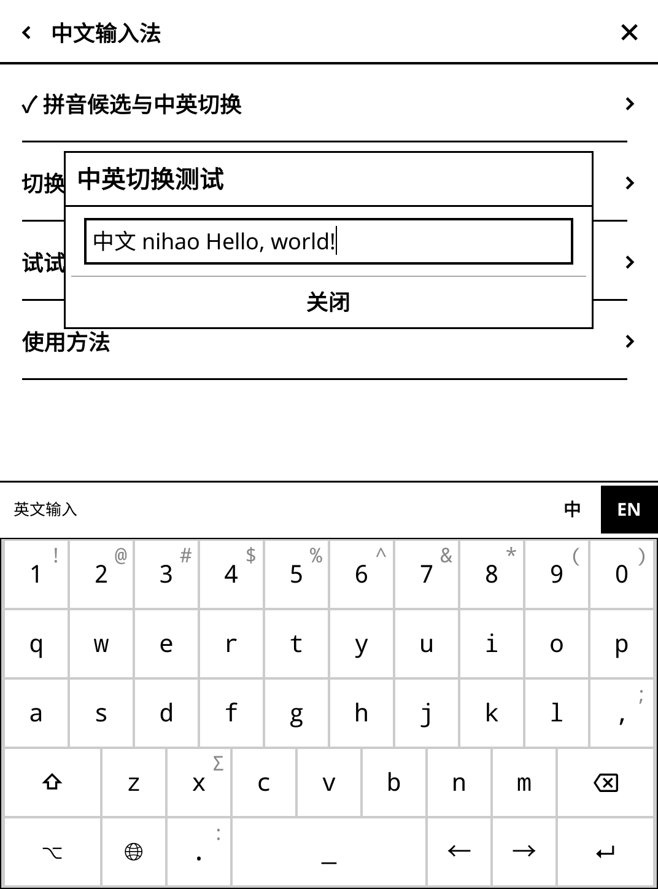
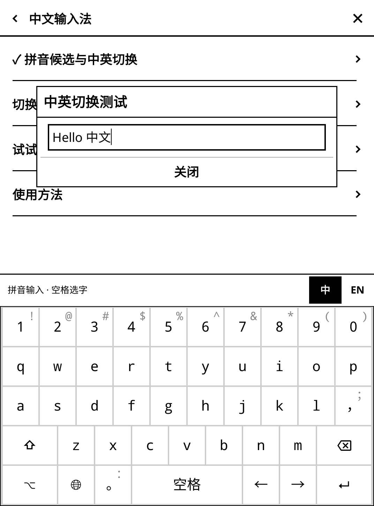

# 墨页 0.5.0-test.6：中英一键切换

键盘上方右侧常驻 **中 / EN** 两个直接点击的选项，深色为当前模式。无需进入设置或长按地球键；英文状态也保留切回中文的入口。

- **点 EN**：切换到原生英文键位、大小写与英文标点。未选字的拼音保留为字母，不擅自变成候选汉字。此前已输入的文字和光标位置保持不变。
- **点中**：回到中文拼音候选输入，点候选或按空格选字。
- **记忆选择**：同步 KOReader 当前布局与默认布局并保存，即使原生“记住布局”选项关闭，下一次输入仍使用最后明确选择的中英文模式。
- **固定高度**：中英文切换栏高度相同，切换时不挤动输入框与确认按钮。
- **保留其他语言**：地球键继续提供原生语言选择。中文键盘设置入口会补齐中文和英文两个布局，同时保留用户原有的其他语言。

生效条件：墨页插件启用、设置 → 触控与按键 → 中文输入法 → 拼音候选与中英切换开启，当前为简体中文或英文布局。数字、密码和显式目录输入框保持直接输入；外部拼音插件避让规则不变，未知输入法插件仍需单独验证。

本版修复了英文状态缺少明确切回入口，以及启用中文时可能没有注册英文布局的问题。候选栏与切换按钮不重叠；过期按钮、关闭输入框后的回调无效；连续切换释放旧的输入适配。

新增检查覆盖三种布局的真实键盘点击、中英往返、未提交拼音与既有文字保留、中间光标输入、英文标点、持久化与关闭原生布局记忆、20 次连续切换、旧回调、其他语言与敏感输入绕过、候选区域边界及布局注册。

本轮重新运行的检查与文件摘要见 `test-results-056/combined-summary.json` 和 `test-results-056/syntax.json`。历史浏览器与网络检查不计入本轮。使用真实 KOReader 控件与引擎的桌面验证，不代表 Kindle 真机延迟和残影验收。

固定支持 KOReader v2026.07.1 / v2026.07.2。安装目录仍为 `einkfrontend.koplugin`，不改核心文件。屏保与其他已发布功能保留。
